<!-- Ahmed Raouf (Arabic). Assets are generated by scripts/build.py -->

<a href="README.md">🇬🇧 English</a> · <b>🇪🇬 العربية</b>

  

  

  
  
  
  
  
  

🧭 <b>Technical Team Lead</b> في <b>QeemaTech</b>، أبني منصات الويب والموبايل من أولها لآخرها

<h2></h2>

<table>
<tr>
<td width="62%" valign="top" dir="rtl">

**Technical Team Lead في QeemaTech**، ومطور Full-stack بخبرة **أكثر من 4 سنوات** في بناء البرمجيات: **Node.js وNestJS وTypeScript** في الـ backend، و**React وNext.js** في الـ frontend.

أقود فريق تطوير بأسلوب Agile/Scrum: أوزع المهام، وأراجع الكود، وأتحمل مسؤولية المعمارية، ومازلت أكتب جزءًا كبيرًا من الكود بنفسي. شغلي اليومي هو تصميم backend قابل للتوسع، ونمذجة قواعد بيانات قوية (MySQL وPostgreSQL)، وواجهات RESTful نظيفة، ودمج **AI/LLM APIs** في منتجات حقيقية.

- 🧭 **Technical Team Lead في QeemaTech**: توزيع المهام، مراجعة الكود، المعمارية، والتسليم في الموعد
- 🚀 **منتجات سلمتها**: Orbex (تطبيق تداول)، Tarteel AI (تطبيق قرآن بالذكاء الاصطناعي)، Stockship، Akfeek، SmoothERP
- 📊 **لوحات Super Admin** بـ React / Next.js لكل منصة اشتغلت عليها
- ⚡ قللت زمن استجابة استعلامات الـ CRM بنسبة **75%** في نظام ERP بشركة 01 Electronics
- 🔁 عملت **Scrum Master** في BookSportz، ودرست مسار Scrum Product Owner من O'Reilly
- 🎓 بكالوريوس علوم الحاسب، الأكاديمية الحديثة بالمعادي؛ مشروع التخرج بتقدير **A+**
- 📍 القاهرة، مصر 🇪🇬 · 📫 **ahmedraouf.metwally@gmail.com**

</td>
<td width="38%" valign="top" align="center">
  
</td>
</tr>
</table>

  

<table>
<tr>
<td width="56%" valign="top" align="center">
  
</td>
<td width="44%" valign="top" dir="rtl">

#### 🧠 طريقة عملي

- **الوضوح أولًا ثم السرعة.** أحسّن الأداء بناءً على قياس، مش تخمين.
- **APIs متوقعة.** متسقة، فيها validation، موثقة، وسهلة الاستخدام.
- **أنمذج البيزنس.** البيانات مبنية على السلوك الحقيقي، مش على الشاشات بس.
- **مسؤولية كاملة.** API وويب ولوحة تحكم، وبعدها متابعة في الإنتاج.
- **أقود بالمراجعة.** مراجعات بتعلّم، وقرارات مكتوبة.

</td>
</tr>
</table>

<h2></h2>

كل بروفايل في الآخر مجرد endpoint، وده بتاعي:

  

<h2></h2>

انضممت في يناير 2026 كمطور Full-stack، واتّرقيت إلى <b>Technical Team Lead</b> في أغسطس 2026. أقود الفريق اللي بيبني ويشغّل منصات الويب والموبايل عندنا.

  

<h2></h2>

  

<h2></h2>

  

<h2></h2>

الشكل اللي ورا Orbex وTarteel AI وStockship وAkfeek: API واحد بـ NestJS يخدم تطبيق الويب وتطبيق الموبايل ولوحة الـ Super Admin، وتحته MySQL، ومميزات الذكاء الاصطناعي في طبقة خدمة منفصلة.

  

<b>إزاي اتبنى</b>

 

| الاحتياج | الحل |
| --- | --- |
| ثلاث واجهات (ويب، موبايل، أدمن) على backend واحد | API واحد بـ NestJS مقسم لـ modules مع DTOs وvalidation مشتركة |
| الأدمن لازم يشوف ويتحكم في كل حاجة | لوحة Super Admin بـ React / Next.js على نفس الـ API |
| مميزات بالذكاء الاصطناعي | استدعاءات الـ LLM معزولة في خدمة خاصة، فباقي التطبيق يفضل بسيط |
| تغييرات في قاعدة البيانات من غير مفاجآت | migrations بـ Prisma / TypeORM تتراجع زي أي كود |
| مستخدمين بصلاحيات مختلفة | مصادقة JWT مع guards وصلاحيات حسب الدور |

<h2></h2>

  
  

  
  

  
  

📇 تفاصيل أكثر على <a href="https://dev-ahmed-raouf.vercel.app/"><b>موقعي</b></a>

<h2></h2>

  

<h2></h2>

  

<h2></h2>

  

  

⏱️ وقت الكود الأسبوع ده، من WakaTime

  

<h2></h2>

  

<h2></h2>

  <picture>
    <source media="(prefers-color-scheme: dark)" srcset="https://raw.githubusercontent.com/Ahmed-Raouf-Metwally/Ahmed-Raouf-Metwally/output/github-snake-dark.svg" />
    <source media="(prefers-color-scheme: light)" srcset="https://raw.githubusercontent.com/Ahmed-Raouf-Metwally/Ahmed-Raouf-Metwally/output/github-snake.svg" />
    
  </picture>

  
  
  
  
  

<i>⚡ متاح دائمًا للتعاون المفيد، والمنتجات اللي عمادها الـ backend، والفرق اللي بتهتم بالتسليم النظيف.</i>

