<!-- Ahmed Raouf: Technical Team Lead & Full-stack Developer. Every card in assets/ is generated by scripts/ (see .github/workflows) -->

<b>🇬🇧 English</b> · <a href="README.ar.md">🇪🇬 العربية</a>

  

  

  
  
  
  
  
  

<h2></h2>

<table>
<tr>
<td width="62%" valign="top">

**Technical Team Lead at QeemaTech** and full-stack developer with **4+ years** of shipping software: **Node.js, NestJS and TypeScript** on the backend, **React and Next.js** on the frontend.

I lead the team in an Agile/Scrum setup: I split the work, review the code, own the architecture, and still write a good share of it. Day to day that means scalable backends, solid data models (MySQL, PostgreSQL), clean RESTful APIs, and **AI/LLM features** in real products.

- 🚀 **Shipped**: Orbex, Tarteel AI, Stockship, Akfeek, SmoothERP
- 📊 A **Super Admin dashboard** in React / Next.js for every platform
- ⚡ Cut CRM query response time by **75%** on an ERP system
- 🔁 Former **Scrum Master**; Scrum Product Owner track (O'Reilly)
- 🎓 B.Sc. Computer Science; graduation project graded **A+**
- 📍 Cairo, Egypt 🇪🇬 · 📫 **ahmedraouf.metwally@gmail.com**

</td>
<td width="38%" valign="top" align="center">
  
</td>
</tr>
</table>

  

<h2></h2>

  

<h2></h2>

<!-- PROJECTS:START (generated from data/profile.yml, edit there) -->

  <a href="https://dev-ahmed-raouf.vercel.app/"></a>
  <a href="https://dev-ahmed-raouf.vercel.app/"></a>

  <a href="https://dev-ahmed-raouf.vercel.app/"></a>
  <a href="https://dev-ahmed-raouf.vercel.app/"></a>

  <a href="https://dev-ahmed-raouf.vercel.app/"></a>
  <a href="https://dev-ahmed-raouf.vercel.app/"></a>

<!-- PROJECTS:END -->

<h2></h2>

  

<h2></h2>

  

<h2></h2>

  

  

<h2></h2>

<b>🧠 How I work</b> · principles + the code version of me

 

<table>
<tr>
<td width="56%" valign="top" align="center">
  
</td>
<td width="44%" valign="top">

- **Readable first, then fast.** Optimize with evidence, not guesses.
- **Predictable APIs.** Consistent, validated, documented and easy to consume.
- **Model the business.** Data shaped around real behavior, not just screens.
- **Own it end to end.** API, web, admin dashboard, then watch it in production.
- **Lead by reviewing.** Reviews that teach, and decisions written down.

</td>
</tr>
</table>

<b>🏢 Currently @ QeemaTech</b> · full-stack dev → Technical Team Lead

 

Joined in January 2026 as a full-stack developer and moved up to **Technical Team Lead** in August 2026. I lead the team that builds and runs our web and mobile platforms.

  

<b>🧰 What I bring</b> · APIs, data, front-ends, dashboards, AI, leadership

 

  

<b>🏗️ How I build a platform</b> · the architecture behind my projects

 

One NestJS API serves the web app, the mobile app and the Super Admin dashboard, with MySQL underneath and AI/LLM features behind their own service layer.

  

| Need | Approach |
| --- | --- |
| Three clients (web, mobile, admin) on one backend | A single modular NestJS API with shared DTOs and validation |
| Admins must see and control everything | A Super Admin dashboard in React / Next.js on the same API |
| AI-powered features | LLM calls isolated in their own service, so the rest of the app stays simple |
| Schema changes without surprises | Prisma / TypeORM migrations, reviewed like any other code |
| Different users, different powers | JWT auth with guards and role-based access |

<b>🎓 Learning &amp; certifications</b> · degree, diploma, Scrum, scholarship

 

  

<b>⏱️ Coding time</b> · a year of WakaTime data

 

  

<b>🎧 Coding soundtrack</b> · what's playing while I ship

 

  

<h2></h2>

  <picture>
    <source media="(prefers-color-scheme: dark)" srcset="https://raw.githubusercontent.com/Ahmed-Raouf-Metwally/Ahmed-Raouf-Metwally/output/github-snake-dark.svg" />
    <source media="(prefers-color-scheme: light)" srcset="https://raw.githubusercontent.com/Ahmed-Raouf-Metwally/Ahmed-Raouf-Metwally/output/github-snake.svg" />
    
  </picture>

  
  
  
  
  

<i>⚡ Open to useful collaboration, backend-heavy products, and teams that care about clean delivery.</i>

